<p align="center">
  
</p>
<h1 align="center">栈渡 · ZhanDu</h1>
<p align="center">跨平台 SSH 工作台。一个窗口内使用终端、管理 SFTP 文件、查看服务器状态。</p>
<p align="center">
  <a href="https://github.com/makessr/ZhanDu/releases/latest"><strong>下载栈渡</strong></a> ·
  <a href="#界面预览">界面预览</a> ·
  <a href="#主机账号同步">主机同步</a> ·
  <a href="#ai-运维助手">AI 助手</a> ·
  <a href="#从源码运行">从源码运行</a>
</p>

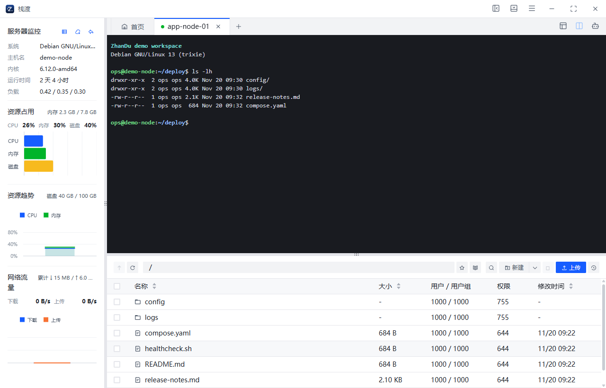

## 下载与安装

**仓库版本** v0.9.0。各版本变动见 [更新日志](CHANGELOG.md)。

栈渡在独立仓库维护和发布。首次安装请从正式发布页下载最新版。已安装栈渡 v0.6.2 或更新版本的用户可直接在应用内检查更新。 [栈渡安装包](https://github.com/makessr/ZhanDu/releases/latest) · [旧渠道 v0.6.1 切换版](https://github.com/makessr/FineShell/releases/tag/v0.6.1)

如果你还在使用 FineShell v0.5.1 或栈渡 v0.6.0，可以在应用内直接升级到 v0.6.1。重启后再次检查更新，后续版本由栈渡独立渠道提供。 [更新渠道迁移说明](docs/release-pipeline.md#从-fineshell-过渡到栈渡)

| 发布目标 | 安装包 |
| --- | --- |
| Windows x64 | `.exe`（NSIS）、`.msi` |
| Windows ARM64 | `.exe`（NSIS） |
| macOS Apple Silicon、Intel | 对应架构的 `.dmg` |
| Linux x64、ARM64 | 对应架构的 `.deb`，适用于 Debian、Ubuntu 等使用 APT 的发行版 |

从 v0.2.0 升级到 v0.3.0 时，请退出 FineShell，下载与当前架构和安装方式一致的安装包，再覆盖安装。v0.2.0 和 v0.3.0 的应用内更新会拒绝本仓库的下载地址。

### macOS 安装

Apple Silicon 下载文件名带 `darwin_aarch64` 的 DMG，Intel 下载带 `darwin_x64` 的 DMG。打开映像后，把 `FineShell.app` 拖到「应用程序」，再打开应用。客户端内显示为「栈渡」。

当前 macOS 包使用临时签名，尚未通过 Apple 公证，首次打开可能被 Gatekeeper 阻止。如果确认安装包来自项目的正式发布页且完整性已校验，可以在第一次尝试打开后，到「系统设置 → 隐私与安全性」检查是否有针对此应用的「仍要打开」按钮。[Apple 的首次打开说明](https://support.apple.com/zh-cn/102445)

可在终端运行 `shasum -a 256 文件名.dmg`，将结果与 [对应版本的正式发布页](https://github.com/makessr/ZhanDu/releases) 对应 DMG 的 SHA-256 比对。[首次安装验收记录](docs/release-pipeline.md#macos-首次安装验收)

### Linux 安装

栈渡 v0.6.2 已在 Debian 12 和 Debian 13 的 XFCE 会话中完成 x64 和 ARM64 安装启动验收，也验证了从 FineShell v0.5.1 经 v0.6.1 到栈渡 v0.6.2 的应用内升级。运行 `dpkg --print-architecture` 查看架构。`amd64` 下载文件名带 `linux_amd64` 的包，`arm64` 下载文件名带 `linux_arm64` 的包。安装后可从 XFCE 应用菜单启动。[Debian XFCE 验收记录](docs/release-pipeline.md#debian-xfce-安装验收)

使用 APT 安装 `.deb`，它会解析 WebKitGTK 等依赖。Linux 安装包从 v0.6.3 起把 `ca-certificates` 声明为依赖，供精简系统验证更新服务的 HTTPS 证书。

```bash
sudo apt update
sudo apt install ./FineShell_0.6.3_linux_arm64.deb
```

请根据实际下载的文件名调整命令。不要直接使用 `dpkg -i`，因为 `dpkg` 不会自动下载缺失的依赖。

如果已经使用 `dpkg -i` 导致软件包处于未配置状态，可执行：

```bash
sudo apt --fix-broken install
```

## 界面预览

截图来自栈渡 Windows 客户端。主机页、SSH 工作区、同步设置表单及密钥生成使用当前开发版，其余功能图来自 v0.6.2 正式版。主机、文件、同步账号和诊断数据均为本地演示数据，AI 回复来自本地演示接口。

### 主机同步

登录后可查看最近同步时间、管理已登录设备并更换主密码。[同步操作和服务部署](#主机账号同步)

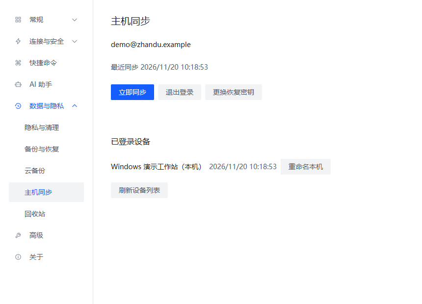

### AI 运维助手

在 SSH 工作区侧栏查看巡检摘要，并为会话选择审批模式。[AI 配置与使用](#ai-运维助手)

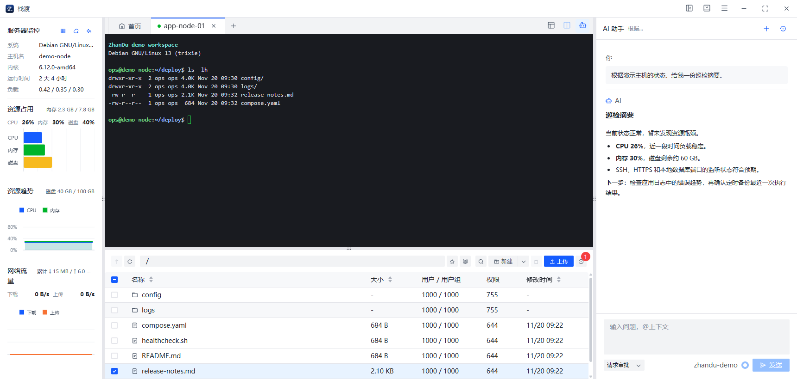

<details>
<summary>主机管理与 SSH 分屏</summary>

主机可按环境分组。在列表上方搜索和排序，在右上角新增主机、导入 OpenSSH 配置或查看连接历史。切到 SSH 会话后，左侧显示服务器监控，终端下方可切换「文件、传输、隧道、进程、网络、命令」。拖动分隔线可调整会话工具区的高度。进程页每行显示一个进程，分列展示 PID、用户、内存、CPU、名称、命令行和路径。路径取自命令行开头的绝对路径。网络页的搜索框旁显示连接数，归属地设置和 AI 入口位于工具栏右侧。命令页可按分组浏览、就地新建命令，并从已连接的会话中选择发送目标。登录主机同步账号后，快捷命令和空分组也会同步。命令编辑器可修改和删除已有命令。搜索框和返回按钮使用当前主题样式。

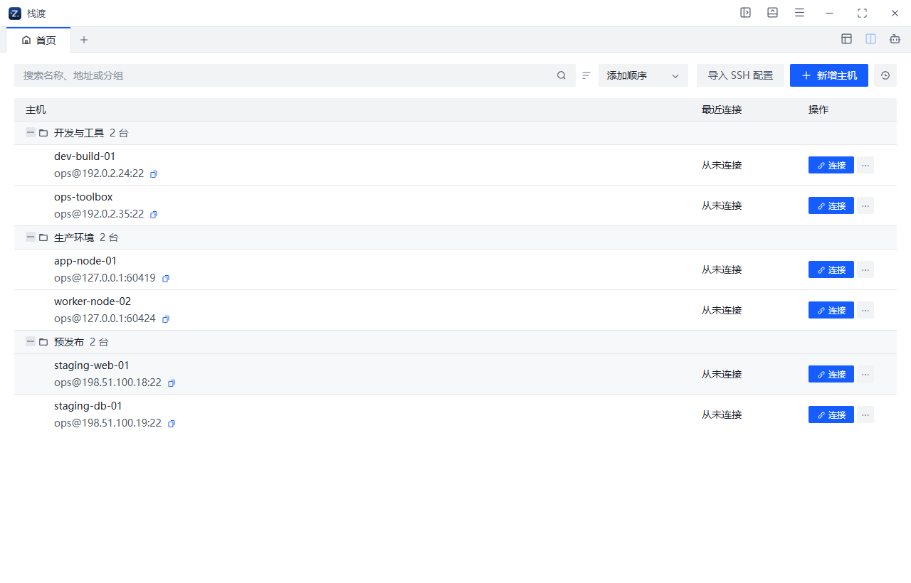

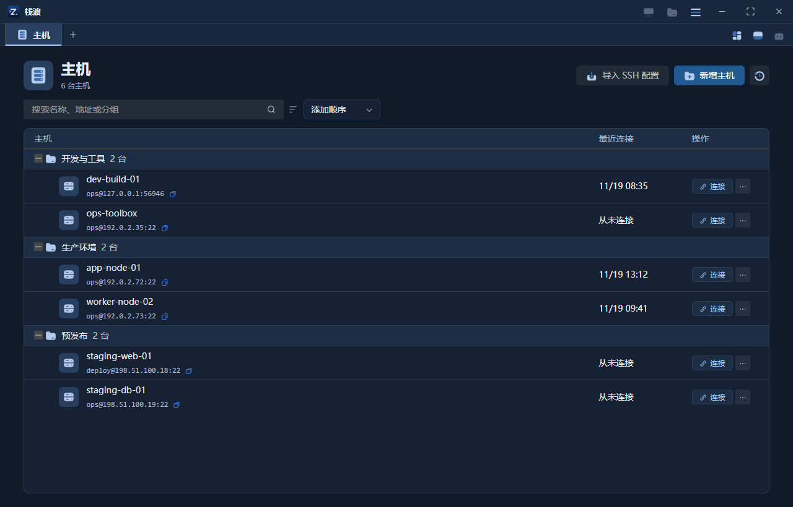

同一个工作区支持并排或上下显示两个 SSH 会话。

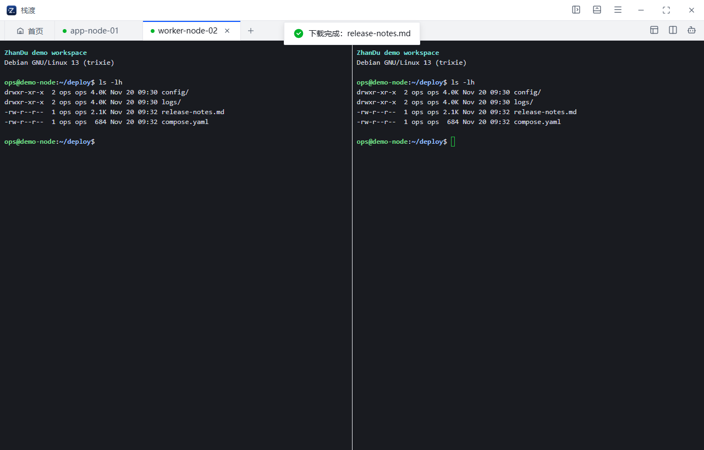

</details>

<details>
<summary>SFTP 文件传输与传输记录</summary>

文件列表与终端同屏，可在传输记录中查看进度、结果和保存位置。

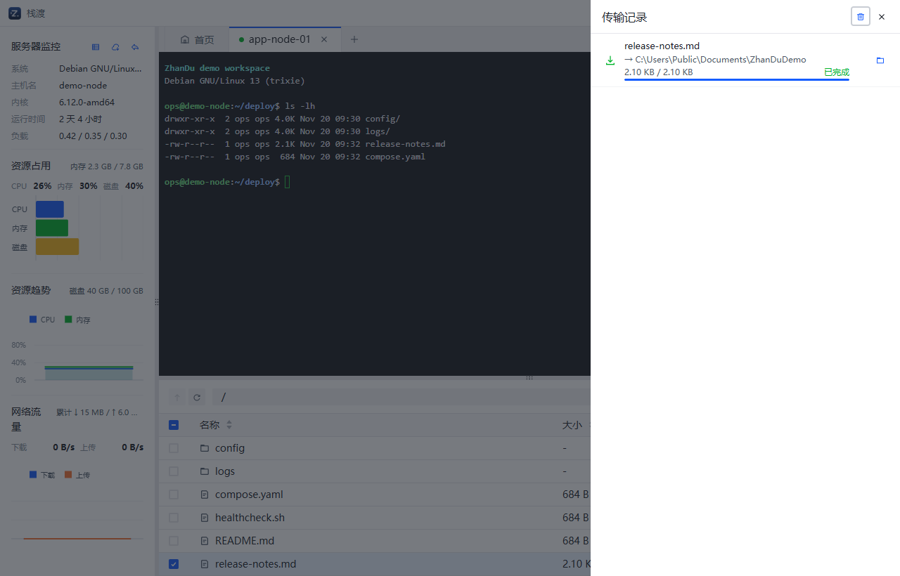

</details>

<details>
<summary>服务器监控、进程管理与网络诊断</summary>

从工作区监控栏打开进程列表，查看 CPU、内存、用户和运行时间。

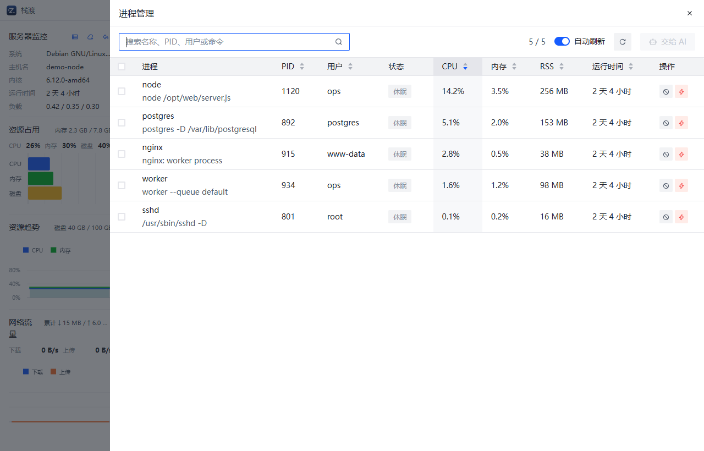

网络诊断支持 Ping、路由追踪和端口监听查询。

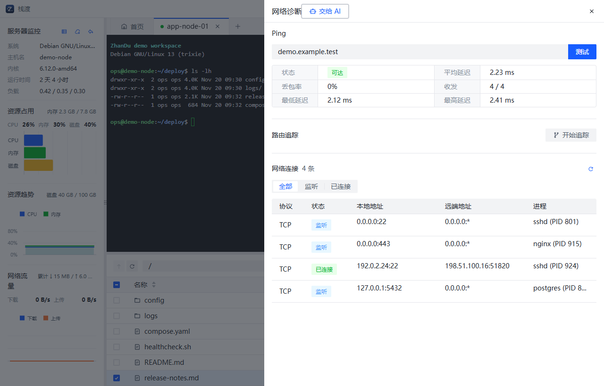

</details>

<details>
<summary>查看栈渡关于页面</summary>

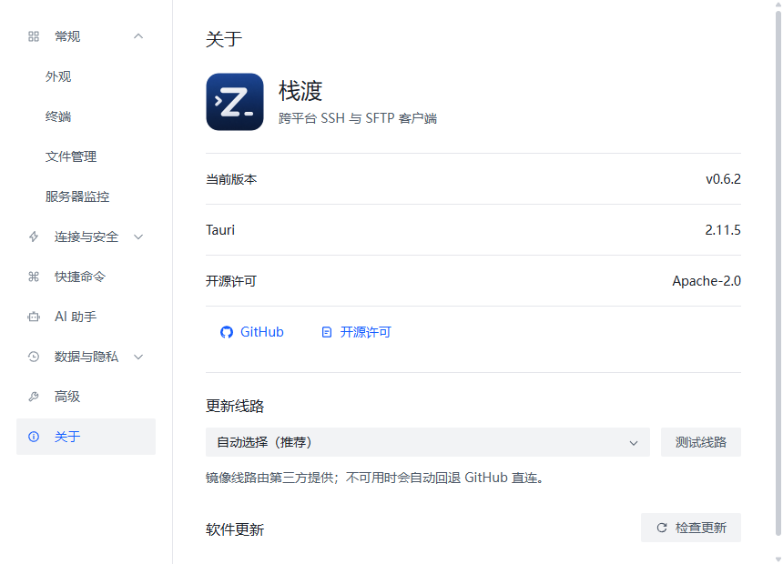

</details>

## 核心能力

| 模块     | 已实现能力                                                   |
| ------ | ------------------------------------------------------- |
| 主机管理   | 分组与树形列表、搜索排序、连接历史、复制与回收站、配置导入导出、OpenSSH 主机配置导入                         |
| SSH 连接 | 密码、私钥、托管密钥和 SSH Agent 认证，SOCKS5 / HTTP CONNECT 代理，一级跳板机 |
| 连接可靠性  | SHA256 主机指纹确认、保活、自动重连、连接取消、结构化错误提示                      |
| 终端     | 多主机会话与分屏、内容搜索、快捷命令和端口转发。默认保留 2,000 行回滚记录，可在设置中调整。 |
| AI 助手  | OpenAI 兼容服务、上下文提及、流式对话、服务器诊断、终端命令与远程文件操作、分级审批和执行结果验证       |
| SFTP   | 上传下载、暂停继续、取消重试、批量拖拽、复制移动、排序、大目录滚动优化、权限及用户/用户组管理 |
| 主机账号同步 | 跨设备自动同步已保存的主机、分组及关联 SSH 凭据，使用主密码或旧恢复密钥在设备端解密 |
| 文件编辑   | 内置文本编辑、调用本地默认或指定编辑器、文件变化自动同步远端、冲突处理                     |
| 归档操作   | 远程压缩与解压、目录及多选项目打包下载，支持 `.tar.gz`、`.tar` 和 `.zip`        |
| 服务器监控  | 默认每 15 秒刷新，记住侧栏的收起状态，收起或窗口最小化、隐藏时暂停采样。监控栏可见时直接显示资源趋势、网卡流量和 SSH 延迟图表。 |
| 应用设置   | 终端、文件管理、监控、连接、代理、密钥、已知主机、隐私清理及备份恢复设置                    |

SSH 工作区可保存当前窗口的已保存主机会话及分屏布局，之后从终端工具栏一键重新连接。OpenSSH 导入支持顶层 `Include`、通配符和嵌套文件。相对路径从所选配置的目录解析。将 `Host` 段中的条件 `Include` 展开后再导入。

SFTP 文件名筛选可从文件管理工具栏的搜索按钮打开，只筛选当前目录，支持文件名和目录名的部分匹配。

工作区深色外观使用中性灰，浅色监控区和 SFTP 文件列表共享工作区底色。终端顶部、底部和左侧的留白跟随所选终端配色。左侧监控从主机 IP 开始，系统信息直接显示，用紧凑横条显示 CPU、内存和交换空间。占用低于 60% 用绿色，60% 至低于 80% 用橙色，80% 及以上用红色。侧栏还显示内存占用最高的五个进程及各挂载点可用容量。磁盘表会隐藏 Docker 容器运行产生的挂载，保留宿主机的磁盘。

在「设置 → 服务器监控 → IP 归属地」可分别下载、导入或删除 IPv4、IPv6 数据。开启后，终端下方「网络」页显示远端连接的归属地。内置下载校验官方数据库的 SHA-256。查询在本机完成，连接地址不会上传。数据来自 [ip2region](https://github.com/lionsoul2014/ip2region)。设置窗口从属于主窗口。

终端下方的工具页签与窗口共用主题底色。网络流量用橙色上传和绿色下载细柱显示，可按网卡查看实时速率和累计流量。流量和延迟柱紧凑排列，保留最近 48 个采样点。资源趋势显示 CPU、内存和根分区磁盘使用率，图例紧邻曲线。资源趋势与网络图共享监控面板底色。下方的服务器延迟为当前 SSH 路径的通道开启耗时估算，当前值显示在图表上方。

在「设置 → 外观」切换主题模式时，主窗口会立即预览。保存设置后应用新主题，撤销更改或关闭未保存的设置会恢复原主题。

监控面板底部按路径列出本地磁盘挂载点，并显示各挂载点的可用容量和总大小。

在「设置 → 终端」可填写以逗号分隔的本机字体名称，调整字号、粗细和行高。背景可选择 PNG、JPEG 或 WebP，设置铺满、完整显示或平铺以及不透明度。图片会压缩后随本机设置保存，原文件移走后仍可使用。保存前可预览效果。

命令输入框显示在当前 SSH 终端下方。回车或点击「发送」将单行命令发到当前分屏，并保留输入框焦点。Tab 补全远程命令或路径，↑ 或 Alt+H 打开该主机在栈渡中的本地命令历史。选中建议只会填入输入框。Ctrl+Shift+L（macOS 可用 Cmd+Shift+L）切换终端和输入框焦点。各项可在终端设置中关闭。

在「设置 → 终端 → 终端主题库」可以搜索主题名称或作者，并预览前景、背景、光标和 16 色 ANSI 色板。主题库离线提供栈渡原有配色及 253 套 [Base24 主题](https://github.com/tinted-theming/schemes/tree/dc265204c014922f11e2cbea72b8fc40aba4f8ee/base24)，也支持跟随界面外观。保存后，已打开的会话会更新配色。[Base24 随附许可](public/licenses/tinted-schemes.txt)

可选择「导入 Ghostty 主题」打开单个主题文件，或使用「刷新主题目录」重新读取本地主题。支持 Ghostty 的十六进制前景、背景、光标、选区和 ANSI 0–15 色。自动扫描 `$XDG_CONFIG_HOME/ghostty/themes`、`~/.config/ghostty/themes` 和 Windows 的 `%LOCALAPPDATA%\ghostty\themes`。选中的 Ghostty 主题会随设置保存为颜色副本，原文件移动后仍可使用。同名文件可重新导入以更新副本。

终端支持目录跟随时，SFTP 会随 `cd` 打开对应目录。如果该目录在 SFTP 中不可见或不可读，文件区保留上一个可用目录，并显示失败路径和原因。

## 生成 SSH 密钥

1. 打开「设置 → 连接与安全 → 密钥」，点击「生成密钥」。栈渡生成 Ed25519 密钥，并在本机托管私钥。
2. 点击「复制安装命令」。用你计划登录的账号打开服务器终端，粘贴并执行命令。命令会把公钥加入该账号的 `~/.ssh/authorized_keys`，并保留已有条目。
3. 在安装窗口选择对应的已保存主机，点击「已安装，验证并启用」。按提示核对服务器指纹。栈渡验证新密钥能登录后才更新主机配置。若能从原私钥识别 OpenSSH 公钥，应用会显示其 SHA-256 指纹并提供复制按钮，方便你在服务器核对后手动撤销旧公钥。

<details>
<summary>查看生成 SSH 密钥界面</summary>

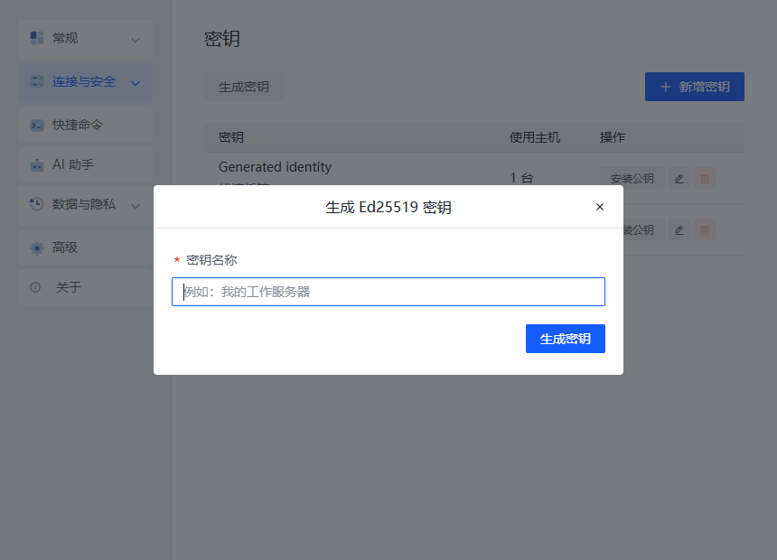

</details>

启用主机同步后，关联到已保存主机的私钥会随该主机端到端加密同步。另一台设备首次解锁同步数据后即可使用这把密钥。单独生成的密钥保留在本机，关联主机后才会参与同步。

## 主机账号同步

快捷命令、模板参数、备注和命令分组（包括空分组）随账号端到端加密同步。两台设备同时修改同一条命令时，可在同步设置中选择保留哪一端。已有本机空分组会自动迁移。账号首次同步命令库后，其他设备需要升级到支持命令同步的客户端。

在「设置 → 主机同步」中创建账号或登录，默认使用 `https://auto.itfans.fun`，也可以填写自建同步服务地址。

<details>
<summary>查看主密码注册、新设备登录和邮箱找回界面</summary>

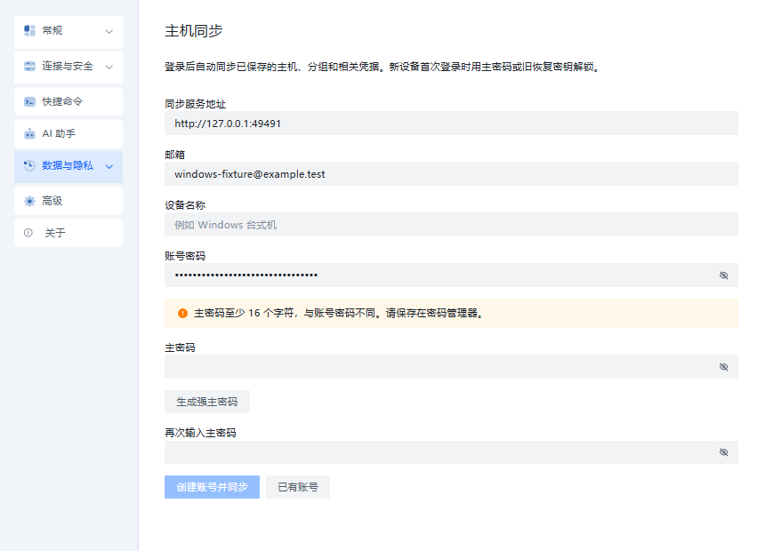

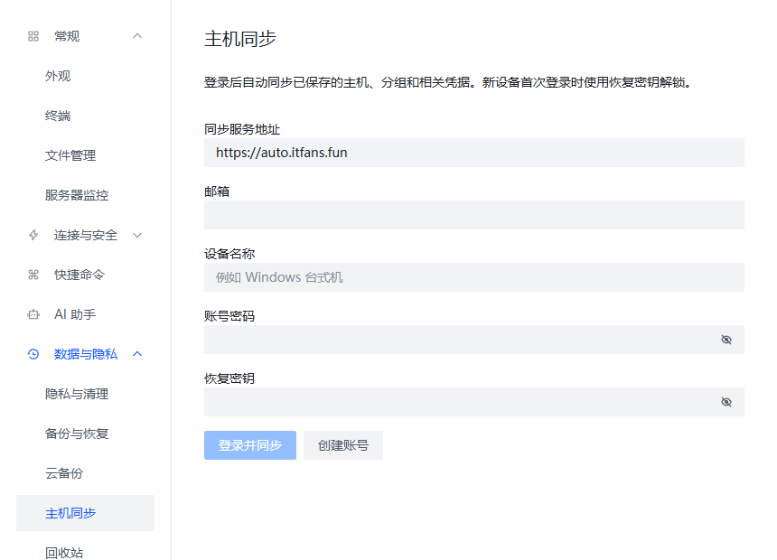

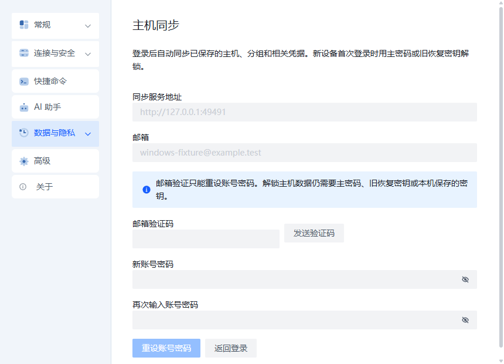

</details>

1. 在第一台设备点击「创建账号」，设置账号密码，以及单独的主密码。主密码至少 16 个字符，可以由栈渡生成，建议存入密码管理器。
2. 在另一台设备填入同一个服务地址、邮箱、账号密码和主密码，点击「登录并同步」。应用自动同步已保存的主机、分组和相关 SSH 凭据。已有设备可沿用系统凭据库保存的解锁密钥。
3. 首次连接每台 SSH 主机时，按提示核对服务器指纹。

应用在设备端加密同步数据。采用旧恢复密钥的账号仍可用原密钥解锁，可在已同步的设备上点击「设置或更换主密码」迁移。自建服务见[同步服务部署指南](sync-server/README.md)。

同步服务标识为 `zhandu`，验证邮件使用栈渡品牌。现有 systemd 部署可按升级步骤切换服务单元，沿用原配置与数据目录。[自建服务升级](sync-server/README.md#升级已有服务)

启用 OPAQUE 的同步服务可以在客户端完成账号密码认证。旧账号从设置中的「迁移旧账号认证」升级。忘记账号密码时，在登录页点击「忘记账号密码」，输入邮箱验证码和新账号密码。重设后用新账号密码重新登录，仍用原主密码或本机已保存的密钥解锁主机数据。[OPAQUE 登录和邮箱找回](sync-server/README.md#opaque-登录和邮箱找回)

### 同步设置

可以在已登录且同步完成的设备上设置或更换主密码。此操作需要验证账号密码，并用新的主密钥重新加密云端数据。其他设备需要升级客户端，再用新主密码重新登录。旧快照仍可能由旧密码或恢复密钥解开。主密码只在客户端使用，务必保存在密码管理器。

自建同步服务支持开放注册、邀请注册和关闭注册三种模式。关闭注册后，已有账号仍可登录和同步。

同步设置可查看和撤销登录设备，并逐条解决同步冲突。私钥文件缺失时，可以重新关联私钥，其他主机仍可同步。云端快照回退后，可在持有较新已验证快照的设备上确认恢复。终端会记住分屏方向，打开两条会话后恢复布局。

### 同步服务备份

服务维护者可以把 SQLite 在线快照加密备份到独立 Windows 电脑，也可以创建能迁移到新 Linux 实例的 AES-256-GCM 加密备份。可在恢复前用 `portable-backup.mjs verify` 检查异机副本和备份密钥。跨系统恢复需要单独保存的备份密钥，并会清除旧登录会话和邀请码。[异机备份与恢复](sync-server/README.md#异机备份与恢复)

## AI 运维助手

栈渡将 AI 助手放在当前 SSH 工作区右侧。它可以结合服务器状态、终端输出和远程文件理解问题，通过受控工具完成信息采集，并在执行终端命令或修改文件前按照当前审批模式处理授权。

<details>
<summary>查看支持的服务、审批模式及配置步骤</summary>

### 主要能力

- 支持 OpenAI、DeepSeek、Ollama，以及其他兼容 OpenAI 接口的自定义服务。
- 支持获取模型列表，并检测基础对话、流式输出和工具调用能力。
- 可以通过 `@` 提及终端选区、最近终端输出、服务器状态、当前远程目录和远程文件；发送前会隐藏检测到的密钥、令牌等敏感内容。
- 提供服务器状态、进程、当前目录、网络连接、Ping 和路由追踪等诊断工具，工具权限可在设置中单独启停。
- 可以生成结构化终端命令，展示用途、执行位置和风险说明，并在执行后采集退出码与结果供 AI 继续分析。
- 可以提出远程文件修改、新建、重命名和删除操作，支持差异审阅、冲突检查、批量应用及安全回滚。
- 支持流式对话、对话历史、长对话自动摘要、任务中断以及 SSH 断线后的受控恢复。

### Agent 工作流程

1. AI 根据问题和显式添加的上下文拆解任务。
2. 通过已授权的只读工具采集服务器证据，并持续更新执行状态。
3. 需要执行命令或变更文件时，在输入框上方展示审批卡片。
4. 用户可以选择同意、拒绝或补充说明。通过审批后，栈渡才会在当前连接中执行操作。
5. 后端记录命令退出状态、文件校验和业务验证结果，再由 AI 根据真实结果继续处理或给出结论。

### 审批模式

| 模式 | 行为 | 适用场景 |
| --- | --- | --- |
| 请求审批 | 受控操作由用户逐项确认 | 初次使用、生产环境和关键主机 |
| 替我审批 | 自动执行经过策略判断的安全操作，风险操作仍需确认 | 日常诊断和重复性维护 |
| 完全访问 | 在当前主机和连接周期内自动执行策略允许的受控操作，超出安全边界的操作仍会被阻止或要求确认 | 明确范围内的连续自动化任务 |

### 开始使用

1. 打开“设置 → AI 助手”，选择服务并填写服务地址、模型和 API Key；API Key 会保存到操作系统凭据库，本地 Ollama 服务可以不填写。
2. 使用“检测能力”确认当前模型是否支持对话、流式输出和工具调用。
3. 连接主机后，点击主窗口右上角的 AI 图标打开侧栏，并选择本次连接使用的审批模式。
4. 直接输入问题，或者使用 `@` 添加需要分析的终端、服务器和远程文件上下文。

</details>

## 从源码运行

### 环境要求

- [Rust stable](https://www.rust-lang.org/tools/install)
- [Bun](https://bun.sh/docs/installation)，CI 当前使用 `1.3.11`
- 对应操作系统的 [Tauri 2 开发依赖](https://v2.tauri.app/start/prerequisites/)

### 启动开发环境

```bash
git clone https://github.com/makessr/ZhanDu.git
cd ZhanDu
bun install --frozen-lockfile
bun run tauri dev
```

### 构建安装包

```bash
bun run tauri build
```

## 开发与测试

GitHub CI 运行前端构建、同步服务测试以及 Rust 测试和 Clippy。Rust 检查（Ubuntu 24.04）和 Linux 发布构建（Ubuntu 22.04 的 x64、ARM64）共用 Ubuntu 官方 HTTPS 软件源配置，分别安装各自的依赖。

```bash
# 前端单元测试、类型检查和生产构建
bun run check

# Rust 单元测试
cargo test --manifest-path src-tauri/Cargo.toml --locked

# Rust 静态检查
cargo clippy --manifest-path src-tauri/Cargo.toml \
  --all-targets --all-features --locked -- -D warnings
```

需要真实服务器的集成测试默认标记为 `ignored`，仅在明确提供 `FINESHELL_LIVE_*` 环境变量时运行。测试可能在远端 `/tmp` 创建临时目录，结束后会自动清理。

<details>
<summary>运行 SFTP 在线测试</summary>

```bash
FINESHELL_LIVE_HOST_ID=<已保存主机 ID> \
FINESHELL_LIVE_ADDRESS=<主机地址> \
FINESHELL_LIVE_PORT=<SSH 端口> \
FINESHELL_LIVE_USERNAME=<用户名> \
cargo test --manifest-path src-tauri/Cargo.toml --lib \
  sftp::tests::completes_a_live_sftp_round_trip -- --ignored --exact
```

</details>

## 技术栈

| 层级    | 技术                                   |
| ----- | ------------------------------------ |
| 桌面运行时 | Tauri 2                              |
| 前端    | React 18、TypeScript、Vite、Arco Design |
| 终端    | xterm.js                             |
| 图表    | VChart                               |
| 后端    | Rust、ssh2、Tokio                      |
| 凭据存储  | keyring / 操作系统凭据库                    |
| 工具链   | Bun、Cargo、GitHub Actions             |

前端通过版本化的 Tauri 命令与事件协议调用 Rust 后端。SSH、SFTP、文件传输和系统监控都在后端执行，前端只接收展示所需的数据与状态事件。

## 贡献

欢迎提交 Issue 和 Pull Request。开始较大改动前，建议先通过 Issue 对齐范围。

- `main` 只接收已经通过 CI 的合并结果，不直接在该分支开发。
- 提交 Pull Request 前请运行 `bun run check`、Rust 测试和 Clippy。
- 每次提交都同步更新本 README。Pull Request 的标题和说明统一用中文，注明用户可见变化和已执行的验证。

## Windows 发布验收

从 v0.5.1 起，Windows 版支持只启用现代椭圆曲线密钥交换的 SSH 服务器。桌面验收使用 Curve25519 握手覆盖该场景。

SFTP 大目录预览会分批显示最先读取的项目，最多预览 1,024 项。读取完成后显示完整目录，可全选、拖拽和执行文件操作。

`scripts/windows-smoke/` 提供两个 PowerShell 入口。同步验收从两套空白 WebView2 配置和独立的 Windows 凭据库命名空间开始。它启动本机的同步和 SSH/SFTP 测试服务，验证登录后自动同步，并以同步得到的 SSH 密码和私钥打开终端、读取 SFTP 目录。OTA 验收从已验签的上一个 Windows x64 NSIS 安装包出发，使用应用内更新并检查本地配置是否保留。运行方法见 [发布流水线](docs/release-pipeline.md#windows-桌面验收)。

## 版本发布

开发过程中将变更记录到 `CHANGELOG.md` 顶部的 `Unreleased` 区域。发布时在 GitHub Actions 中运行 `Prepare Release` 并选择版本级别，工作流会统一升级版本、整理更新日志并创建发布 PR。发布工作流启用时，合并发布 PR 会按仓库变量 `FINESHELL_RELEASE_PLATFORMS` 构建安装包并校验 OTA 更新清单。工作流保存产物和发布说明，核对草稿的版本标签与目标提交，由维护者验收后手动公开。

GitHub 仓库需要配置 Tauri 更新签名私钥 `TAURI_SIGNING_PRIVATE_KEY`。完整架构与失败重试方式见 [发布流水线文档](docs/release-pipeline.md)。

发布构建在 Actions 保存各架构的 Cargo 计时报告，便于查找 Rust 编译瓶颈。
macOS Intel 安装包在 Apple Silicon 运行器上交叉编译，安装与应用内升级在 Intel 运行器上验收。
Windows ARM64 发版可单独复用内置 OpenSSL 静态库，缓存收集兼容 Cargo 1.100 的构建目录。公开发布后，可用 [Verify public OTA](docs/release-pipeline.md#公开渠道升级验收) 批量验证 Windows、macOS 和 Debian XFCE。 工作流先核对最新公开版本的更新清单和旧安装包校验值，再由客户端执行应用内升级。

公开草稿前，在 Actions 运行 `Audit release assets`。它用当前公开版的验签公钥核验各平台更新包，同时核对发布提交、产物 SHA-256 和更新清单。[草稿验收步骤](docs/release-pipeline.md#草稿产物验收)

## 开源许可

客户端「关于」页可直接打开栈渡的 GitHub 仓库和许可证。

桌面工作区的部分双色图标来自 [Kubai Icons](https://github.com/kubai087/kubai-icons)，随客户端离线提供，使用 [MIT 许可证](public/icons/kubai/LICENSE.txt)。主机页将连接列表、搜索排序和主机操作分开，界面包含浅色和深色主题。

栈渡由 makessr 独立维护，源自 Max0897 开发的 FineShell，沿用 Apache-2.0 许可证。[原作者 Max0897](https://github.com/Max0897) · [原项目 FineShell](https://github.com/Max0897/FineShell) · [许可证](LICENSE)
